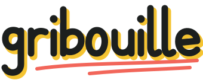
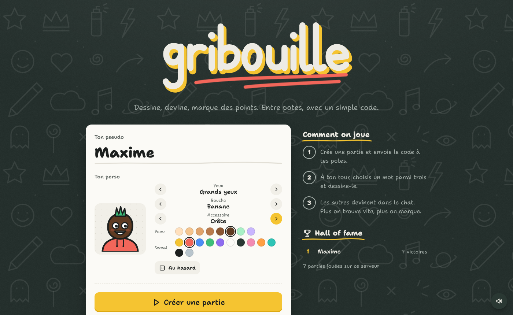
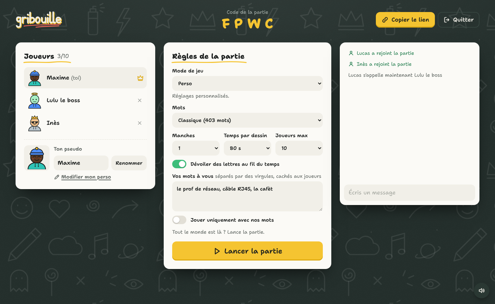
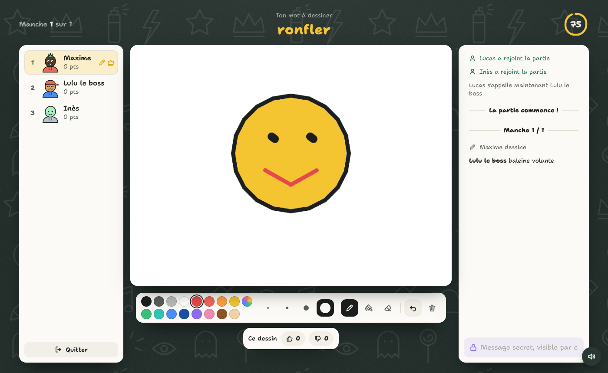
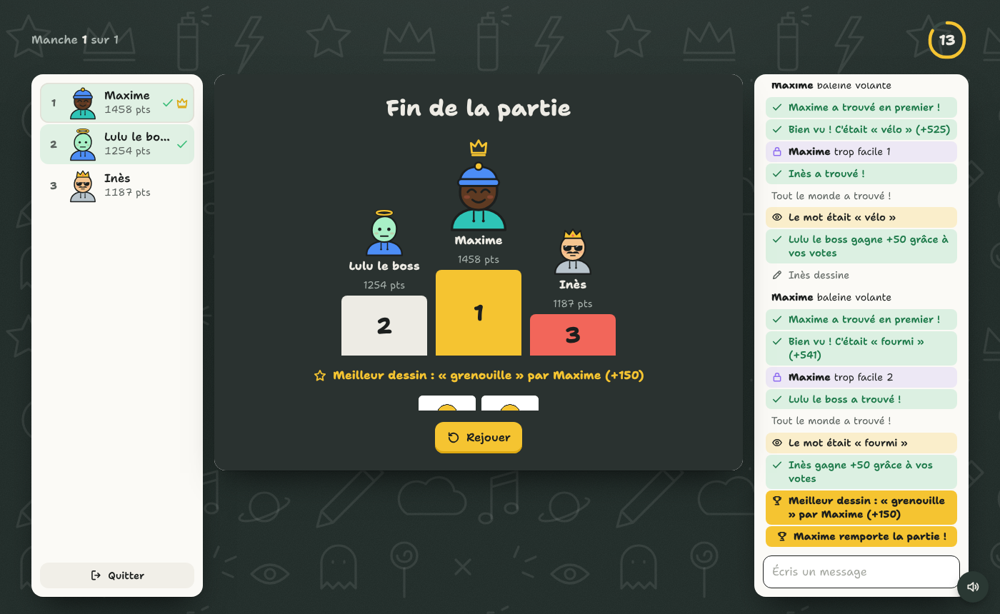

<div align="center">



**Dessine, devine, marque des points.** Un jeu de dessin multijoueur entre potes, entièrement conteneurisé.

Projet du cours de conteneurisation · B3 SRC · ESGI Reims



</div>

## Le jeu

Un joueur crée une partie et reçoit un code à 4 lettres, ou un lien à partager. Les autres rejoignent depuis un PC ou un téléphone. À chaque tour, un joueur choisit un mot parmi trois et le dessine. Les autres tapent leurs propositions dans le chat : plus on trouve vite, plus on marque.

- **Ton pseudo et ton perso** : peau, sweat, yeux, bouche, accessoire, modifiables à tout moment dans le salon.
- **Réponses proches gardées privées** : un « tu chauffes » n'est visible que par son auteur, pour ne pas souffler la réponse aux autres.
- **Chat secret** entre le dessinateur et ceux qui ont déjà trouvé.
- **Réponses tolérantes** : majuscules, accents, tirets et même « c'est un chat ? » sont acceptés.
- **Modes de jeu et paquets de mots** : normal, rapide, facile, geek, expert, hardcore, 574 mots au total.
- **Mots perso cachés aux joueurs** : seul l'hôte les voit, avec l'option « uniquement nos mots ».
- **Vote pour le dessin** : des points bonus pour le dessinateur, et une récompense pour le meilleur dessin de la partie.
- **Mot masquable** pour le dessinateur, contre les regards quand on joue dans la même pièce.
- **Reconnexion automatique** : un rafraîchissement ou une coupure réseau ne fait pas perdre ses points.
- **Outils de dessin** : crayon, gomme, pot de peinture, 4 épaisseurs, 16 couleurs et une couleur libre, annuler (Ctrl+Z).
- **Fin de partie** : podium animé, galerie des dessins de la partie, bouton Rejouer, Hall of fame persistant.
- **Zéro dépendance externe** côté navigateur : polices et icônes hébergées avec le jeu, CSP stricte. Ça marche en LAN sans internet.
- **Compatible avec les navigateurs anti-pistage** (LibreWolf, Brave, Tor) : le jeu ne relit jamais le canvas.

## Lancer en 30 secondes

Prérequis : Docker et Docker Compose.

```bash
git clone https://github.com/ArtmenFR/gribouille.git
cd gribouille
docker compose up -d --build
```

Puis ouvrir **http://localhost:8080**. Pour changer le port : `PORT=3000 docker compose up -d`.

Le `Makefile` regroupe les commandes utiles : `make help` affiche la liste (`up`, `down`, `logs`, `test`, `dev`, et les démos pour la soutenance).

## Jouer avec ses potes

| Situation | Comment faire |
|---|---|
| Même Wi-Fi | Partager `http://<ton-IP-locale>:8080` (sur Linux : `hostname -I`) |
| À distance, sans configuration | `cloudflared tunnel --url http://localhost:8080` puis partager l'URL donnée |
| Réseau privé entre potes | Tailscale : chacun rejoint le réseau et utilise ton IP Tailscale |
| Serveur maison ou VPS | Lancer la stack dessus et ouvrir le port, idéalement derrière un proxy HTTPS |

## Documentation

| Document | Contenu |
|---|---|
| [`docs/RAPPORT.md`](docs/RAPPORT.md) | **Le rapport complet du projet** : démarche, choix, sécurité, problèmes rencontrés et solutions |
| [`docs/CONTENEURISATION.md`](docs/CONTENEURISATION.md) | Chaque notion Docker utilisée et le déroulé de démonstration |
| [`docs/ARCHITECTURE.md`](docs/ARCHITECTURE.md) | Fonctionnement du jeu : protocole, score, anti-triche, rendu |
| [`CHANGELOG.md`](CHANGELOG.md) | Historique des versions |
| [`CONTRIBUTING.md`](CONTRIBUTING.md) | Travailler à plusieurs sur le projet |
| `/charte.html` dans le jeu | Charte graphique complète |

## Architecture

```
            Navigateurs (PC, téléphone)
                     │  HTTP + WebSocket
                     ▼
        ┌────────────────────────────┐
        │  web : nginx               │   seul conteneur exposé (port 8080)
        │  front + reverse proxy     │
        └─────────────┬──────────────┘
          réseau front│
        ┌─────────────▼──────────────┐
        │  server : Node + Socket.io │   logique du jeu
        │  non-root, lecture seule   │
        └─────────────┬──────────────┘
          réseau back │ (interne)
        ┌─────────────▼──────────────┐
        │  redis                     │   classement persistant (volume)
        └────────────────────────────┘
```

Toutes les notions Docker utilisées (multi-stage, réseaux, volumes, healthchecks, durcissement, CI) sont expliquées dans **[`docs/CONTENEURISATION.md`](docs/CONTENEURISATION.md)**, avec le déroulé de démonstration pour la soutenance. Le fonctionnement du jeu (protocole, score, anti-triche) est dans [`docs/ARCHITECTURE.md`](docs/ARCHITECTURE.md).

## Charte graphique

L'identité visuelle complète (logo, couleurs, typographie, icônes, persos, composants, animations, ton) est consultable directement dans le jeu à l'adresse **`/charte.html`**, ou dans [`web/public/charte.html`](web/public/charte.html).

## Arborescence

```
gribouille/
├── docker-compose.yml        Stack de référence : web + server + redis
├── docker-compose.dev.yml    Surcharge dev : code monté, rechargement auto
├── docker-compose.ghcr.yml   Utiliser les images publiées par la CI
├── Makefile                  Commandes et démos
├── server/                   Serveur de jeu (Node.js)
│   ├── Dockerfile            Image multi-stage, non-root
│   ├── src/
│   │   ├── index.js          Point d'entrée HTTP + Socket.io
│   │   ├── game.js           Salons, tours, scores, anti-triche
│   │   ├── store.js          Classement Redis
│   │   └── words.js          Paquets de mots et modes de jeu
│   └── test/                 Tests unitaires et partie simulée
├── web/                      Front + reverse proxy
│   ├── Dockerfile
│   ├── nginx.conf            Proxy WebSocket, en-têtes de sécurité
│   └── public/               Pages, styles, logo, icônes, persos, polices
├── CHANGELOG.md              Historique des versions
├── docs/
│   ├── RAPPORT.md            Rapport complet du projet
│   ├── CONTENEURISATION.md   Dossier technique du cours
│   ├── ARCHITECTURE.md       Fonctionnement du jeu
│   └── screenshots/
└── .github/                  CI, modèles d'issues et de PR
```

## Tests

```bash
cd server && npm ci && npm test
```

Les 10 tests lancent un vrai serveur et de vrais clients Socket.io qui jouent : création, code, choix du mot, dessin, devinettes, chat secret, reconnexion, changement de pseudo, exclusion, modes de jeu, votes et meilleur dessin. Ils vérifient aussi que le mot ne fuite jamais chez ceux qui doivent le deviner. La CI les relance à chaque push, construit les images et vérifie que la stack démarre.

## Développer sans Docker

```bash
cd server
npm install
npm run dev          # http://localhost:3000, redémarre à chaque modification
```

Sans `REDIS_URL`, le jeu fonctionne normalement, seul le Hall of fame est désactivé.

## Contribuer

La méthode de travail à plusieurs et les idées d'amélioration sont dans [`CONTRIBUTING.md`](CONTRIBUTING.md) : une branche par fonctionnalité, une pull request, les tests au vert.

## Captures

| Salon | Le dessinateur | Fin de partie |
|---|---|---|
|  |  |  |

## Licence

MIT, voir [`LICENSE`](LICENSE).
