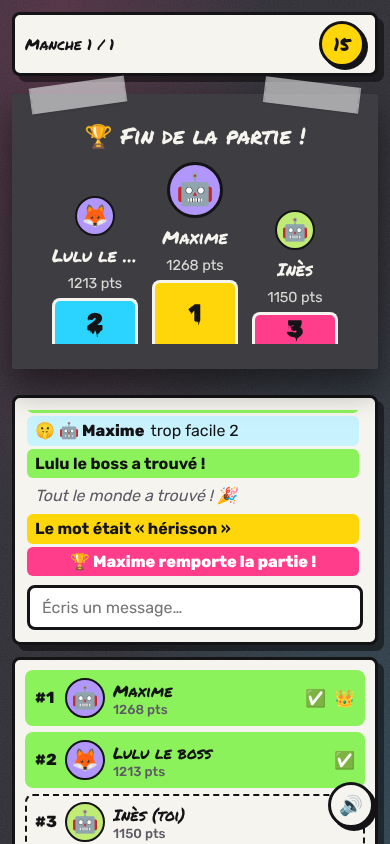

<div align="center">

# 🎨 Gribouille

**Tague, devine, rigole.** Un jeu de dessin multijoueur entre potes, ambiance street, 100 % conteneurisé.


</div>

---

## ✨ Ce que fait le jeu

Un joueur crée une partie et reçoit un **code à 4 lettres** (ou un lien à partager). Les autres rejoignent avec ce code, depuis un PC ou un téléphone. À chaque tour, un joueur choisit un mot parmi trois et le dessine ; les autres tapent leurs propositions dans le chat. Plus on trouve vite, plus on marque.

**Ce qu'on a en plus de skribbl.io :**

- 🏷️ Ton pseudo et ton avatar (24 emojis × 12 couleurs), modifiables à tout moment dans le salon
- 🔥 Les réponses « presque justes » ne sont visibles **que par leur auteur** (pas de réponse soufflée aux autres)
- 🤫 Chat secret entre le dessinateur et ceux qui ont déjà trouvé
- ✍️ Réponses tolérantes : majuscules, accents, tirets et même « c'est un chat ? » sont acceptés
- 🧠 Mots perso **cachés aux joueurs** (seul l'hôte les voit), avec option « uniquement nos mots »
- 🔄 Reconnexion automatique : un rafraîchissement ou une coupure réseau ne fait pas perdre ses points
- 🪣 Pinceau, gomme, pot de peinture, 4 tailles, 16 couleurs, annuler (Ctrl+Z), raccourcis clavier
- 🏆 Podium de fin de partie et **Hall of fame** persistant (Redis)
- 👍 Réactions sur les dessins, sons générés sans fichiers
- 🔒 Zéro dépendance externe côté navigateur : polices auto-hébergées, CSP stricte, ça marche même sans internet en LAN
- 📱 Jouable au doigt sur mobile

## 🚀 Lancer en 30 secondes

Prérequis : Docker et Docker Compose.

```bash
git clone <url-du-repo> gribouille
cd gribouille
docker compose up -d --build
```

Puis ouvre **http://localhost:8080**. Pour changer le port : `PORT=3000 docker compose up -d`.

Raccourcis disponibles via le Makefile : `make up`, `make down`, `make logs`, `make test`, `make dev`.

## 🐳 Images Docker prêtes à l'emploi

À chaque push sur `main`, la CI publie les images sur GitHub Container Registry (`ghcr.io/<owner>/gribouille-web` et `gribouille-server`). Sur n'importe quelle machine avec Docker, plus besoin de builder :

```bash
GH_OWNER=<pseudo-github> docker compose -f docker-compose.yml -f docker-compose.ghcr.yml up -d --pull always --no-build
```

Après le premier push, passe les deux paquets en **Public** (GitHub, onglet *Packages*, *Package settings*) pour que tout le monde puisse les tirer sans se connecter.

## 🌍 Jouer avec ses potes

| Situation | Comment faire |
|---|---|
| **Même Wi-Fi / même réseau** | Partage `http://<ton-IP-locale>:8080` (sur Linux : `hostname -I`) |
| **À distance, sans rien configurer** | `cloudflared tunnel --url http://localhost:8080` ou `ngrok http 8080`, puis partage l'URL donnée |
| **Réseau privé entre potes** | Tailscale ou ZeroTier : chacun rejoint le réseau et utilise ton IP Tailscale |
| **Serveur maison / VPS** | Lance la stack dessus, ouvre le port (ou mets un reverse proxy HTTPS devant) |

## 🏗️ Architecture

```
            Navigateurs (PC / mobile)
                     │  HTTP + WebSocket
                     ▼
        ┌────────────────────────────┐
        │  web : nginx               │   ← seul conteneur exposé (port 8080)
        │  front statique + reverse  │
        │  proxy + en-têtes sécu/CSP │
        └─────────────┬──────────────┘
          réseau front│
        ┌─────────────▼──────────────┐
        │  server : Node + Socket.io │   ← logique du jeu, état des salons
        │  non-root, read-only,      │
        │  cap_drop ALL              │
        └─────────────┬──────────────┘
          réseau back │ (internal)
        ┌─────────────▼──────────────┐
        │  redis                     │   ← classement persistant (volume)
        │  injoignable de l'extérieur│
        └────────────────────────────┘
```

Plus de détails (protocole Socket.io, règles de score, choix de sécurité) dans [`docs/ARCHITECTURE.md`](docs/ARCHITECTURE.md).

## 📁 Arborescence

```
gribouille/
├── docker-compose.yml        # Stack de prod : web + server + redis
├── docker-compose.dev.yml    # Surcharge dev : code monté, rechargement auto
├── docker-compose.ghcr.yml   # Utiliser les images publiées par la CI
├── Makefile                  # Raccourcis (up, down, logs, test, dev)
├── .env.example              # Variables configurables
├── server/                   # Serveur de jeu (Node.js)
│   ├── Dockerfile
│   ├── package.json
│   ├── src/
│   │   ├── index.js          # Point d'entrée HTTP + Socket.io
│   │   ├── game.js           # Moteur : salons, tours, scores, anti-triche
│   │   ├── store.js          # Classement Redis (optionnel)
│   │   └── words.js          # Liste de mots
│   └── test/                 # Tests unitaires + partie complète simulée
├── web/                      # Front + reverse proxy
│   ├── Dockerfile
│   ├── nginx.conf
│   └── public/               # index.html, style.css, app.js, fonts/
├── docs/
│   ├── ARCHITECTURE.md
│   └── screenshots/
└── .github/                  # CI, modèles d'issues et de PR
```

## 🧪 Tests

```bash
cd server && npm install && npm test
```

Les tests lancent un vrai serveur et de vrais clients Socket.io qui jouent une partie entière : création, code, choix du mot, dessin, devinettes, chat secret, reconnexion, exclusion. Ils vérifient aussi que **le mot ne fuite jamais** chez ceux qui doivent le deviner. La CI GitHub les relance à chaque push et build les images Docker.

## 🛠️ Développer sans Docker

```bash
cd server
npm install
npm run dev          # http://localhost:3000, redémarre à chaque modif
```

Sans `REDIS_URL`, le jeu marche normalement, seul le Hall of fame est désactivé.

## 🤝 Contribuer

Les idées d'amélioration et la façon de travailler à plusieurs sont dans [`CONTRIBUTING.md`](CONTRIBUTING.md). En bref : une branche par fonctionnalité, une PR, les tests au vert.

## 📸 Captures

| Salon | Le dessinateur | Podium (mobile) |
|---|---|---|
|  |  |  |

## 📄 Licence

MIT, voir [`LICENSE`](LICENSE).
